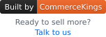

<a href="https://commercekings.net"></a>

# Flash-Sale-Ready Abandoned Cart

Works with Magento 2.4+ · Luma and Hyvä (Luma checkout) · PHP 8.1–8.5 · RabbitMQ or MySQL queue

[](LICENSE) [](https://github.com/commercekings/module-abandoned-cart/releases) [](https://github.com/commercekings/module-abandoned-cart/actions)

**Everyday reliable, never slows your store.** A well-timed email for every abandoned cart.

- **Built for traffic.** Checkout only saves the email; sending runs in the background – thousands of reminders a
  minute, every cart exactly once (see *Where it shines* below).
- **Your rules.** Opt-in with a cookie banner, or opt-out with an optional checkout notice. Set the delay, hourly limit,
  template, sender and notice text – or plug in your own reminder schedule.
- **Back to the cart in one click.** A signed link restores the saved cart and merges it into the shopper's current
  one.
- **Respectful by design.** A recipient cooldown, and no email after a shopper says no.

## Installation

**Opt-out** – a reminder for every shopper who enters an email in checkout:

```sh
composer require commercekings/module-abandoned-cart:^0.1
bin/magento setup:upgrade
```

**Opt-in** – reminders only with consent, with the cookie banner:

```sh
composer require commercekings/module-abandoned-cart:^0.1 commercekings/privacy-bundle:^0.1
bin/magento setup:upgrade
```

| | Opt-out | Opt-in |
|---|---|---|
| Who gets a reminder | every shopper who entered an email | only with consent for `cart_reminder` |
| Checkout notice | on, optional | off |
| Email button | opens the cart page | restores the saved cart, only in the browser that consented |
| Unsubscribe link | none until you add your own page | signed link, optional one-click headers |
| Consent tables | none | created |

To move a shop from opt-in to opt-out, uninstall the **consent bridge**, the **cookie banner** and **Consent** with
`bin/magento module:uninstall`, then `composer remove commercekings/privacy-bundle`.

## Settings

**Stores > Configuration > CommerceKings > Abandoned Cart**:

| Field | Default |
|---|---|
| Enabled (store) | No |
| Inactivity delay (minutes) | 180 |
| Maximum reminders per hour | 0 = no limit – set your email provider's limit |
| Email template (store) | Abandoned Cart Reminder – neutral, for both setups |
| Sender (store) | General Contact |
| Show notice | Automatic – Yes without consent, No with consent |
| Notice text (store) | If you leave your cart, we may email you one reminder about it. |

Carts expire with Magento's *Quote Lifetime* (normally 30 days). The recipient cooldown (7 days per address) and the
optional one-click unsubscribe headers are under **CommerceKings > Notifications**.

To change the email, load the template in **Marketing > Email Templates**. Variables: `customer_name`, `items_html`,
`grand_total`, `restore_url`, `optout_url`, `contact_url`, `store_url`; keep the unsubscribe line inside
`{{depend optout_url}}`.

## Before going live

- Set *Maximum reminders per hour* to your email provider's limit.

**Recommended**

- Run the consumer `commerceKingsNotificationSend` with `--max-messages=1000`, so long-running workers recycle.
- To scale, run more consumers in parallel. Number of consumers = email provider's limit per second ÷ emails one
  consumer sends per second.
- Rate-limit the guest subscribe endpoint in nginx or your proxy
  ([how](https://github.com/commercekings/module-notification/blob/main/docs/operations.md#rate-limiting)).

**Note:** If you turn on the optional *One-click unsubscribe*, send from a no-reply address whose domain DKIM-signs
the unsubscribe headers, as [RFC 8058](https://www.rfc-editor.org/rfc/rfc8058) requires.

## Extending

Replace any of these with a DI preference:

`Api\ReminderPolicyInterface` – when to send (default: once per cart)

`Api\UnsubscribeLinkInterface` – your own unsubscribe page

`Api\ReminderEmailResolverInterface` – where the recipient comes from

## Where it shines

A flash sale leaves thousands of carts abandoned at once, and every shopper gets one reminder
within minutes. In a load test on a local sandbox (Magento 2.4.9 in production mode, 14 CPUs / 8 GB, RabbitMQ),
12 consumers sent 13,333 reminder emails a minute – every cart exactly once, no email after a withdrawal, no
deadlocks – while checkout subscribe and unsubscribe held p95 under 80 ms at 50 requests a second, with zero errors.

## Limitations

- One reminder per cart; follow-ups need another reminder policy. The restore link shows the cart as it is now and
  works for 7 days.
- A worker killed mid-send can leave a cart marked as reminded without an email – it is never sent twice.

## More

[How it works](docs/how-it-works.md) · [Security and links](docs/security.md) · [Testing](docs/testing.md) ·
[Compatibility](COMPATIBILITY.md) · [Changes](CHANGELOG.md)

## Disclaimer

These modules help you ask for, record and respect your shoppers' choices – they don't make your store compliant on
their own. You are responsible for your store's privacy: what you collect, the wording you show, your privacy policy
and whether your setup meets the laws that apply to you (e.g. GDPR, ePrivacy, email marketing rules). Get legal advice
if you are unsure.
